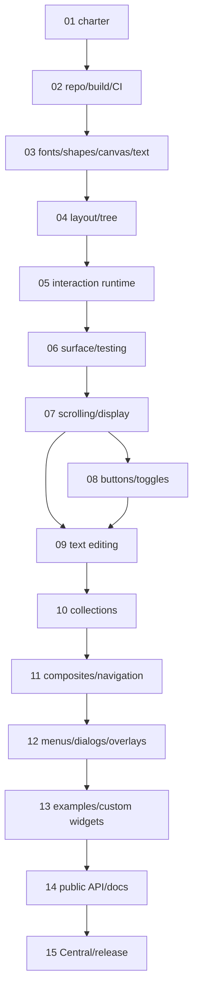

# terminal-window-gui — sectioned build guide

Guide only. No implementation code lives in these files; each section is one
unit of work sized for one conversation.

- Artifact: `com.psiwray.organization:terminal-window-gui`
- Version: `1.0.0`; development version `1.0.0-SNAPSHOT`
- Repository: `psiwray-corp/terminal-window-gui`
- Host library: `com.psiwray.organization:terminal-window:2.0.0`
- Modules: `:library`, `:examples`
- License: MIT; bundled font CC0-1.0

## How to use

1. Read this file only.
2. Read exactly one `docs/guide/NN-*.md`. Do not read sibling sections;
   cross-section constraints are fixed here.
3. Reuse the `terminal-window` files named in the section instead of
   re-deriving them.
4. Implement only that section's deliverables. Do not pre-implement later
   sections; add a private seam if a later section needs a hook.
5. Update the checklist here and leave all changes uncommitted for the user.
6. A section is done only when every `## Acceptance` box is demonstrated, not
   inferred.

## Context budget

Each section is one conversation. The target is at most 30% of a 1M-token
context, including file reads, generated code, test output, and review. If a
section approaches that ceiling, stop and split at the seam named in its
`## Context budget` block rather than continuing.

Do not read sibling section files. `GUIDE.md` is the only shared state between
conversations.

## Fixed facts (do not re-derive)

| Fact | Value | Why |
|---|---|---|
| Group / artifact | `com.psiwray.organization` / `terminal-window-gui` | One published library artifact |
| Version | `1.0.0`, development `1.0.0-SNAPSHOT` | First release |
| Language | **Kotlin 2.4.21**, JVM target 25 | Same toolchain as `terminal-window` |
| JDK | **25** toolchain | Same runtime as `terminal-window` |
| Gradle | 9.9.1 wrapper, Kotlin DSL, version catalog | Same build baseline |
| Host library | `com.psiwray.organization:terminal-window:2.0.0` | Published renderer/input source; no core changes in v1 |
| Modules | `:library`, `:examples` | Library plus runnable proofs; **no `:benchmarks`** |
| Package root | `com.psiwray.organization.terminal_window_gui` | No split package with `terminal_window` |
| Automatic module name | `com.psiwray.organization.terminal_window_gui` | Stable module-path name; no `module-info` |
| License | MIT | Same license as `terminal-window` |
| Bundled font | `fonts/terminal-window-gui-8x16.twf`, CC0-1.0 | Covers ASCII and every v1 shape |
| Shape model | Semantic `Shape` roles; per-shape primary + fallback; global last resort | No hardcoded shape glyphs; any capable font |
| Ownership | Passive `GuiSurface`; caller owns window, loop, threads, timers, GL | The library never becomes the window owner |
| Coordinates | Widget bounds local to parent content; `PaintContext` origin/clip; root only is screen | Supports relative positioning, scrolling, movable subtrees |
| Sizing | One `measure(constraints)` path; no mutable Swing-style preferred/min/max | Content and layout stay coupled |
| Repaint | Caller invokes `paint`; full surface paint into `TerminalMatrix`; matrix dirty bit decides upload | No library-owned frame loop or background painter |
| Threading | Single-thread-affine surface; no internal threads, coroutines, or timers | The caller owns concurrency |
| Text width | One Unicode code point occupies one cell in v1 | `terminal-window` has no width model |
| Testing | `GuiTestHarness`, golden cell grids, synthetic events, fake clock; GL only in integration | Thorough component testing without a display |
| CI | GitHub Actions + Forgejo; shared `ci/*.sh` | Same logic as `terminal-window` |
| Release | `master` snapshot -> `release/<major.minor>` -> signed tag; local signing; nmcp | Same strategy as `terminal-window` |
| Native classifiers | Never in the published POM | Consumers add LWJGL natives |

## Non-negotiable invariants

1. **No window ownership.** The library never calls `TerminalWindowService`,
   `TerminalWindow.frame`, `requestRepaint`, `setCursor`, `setTitle`,
   `requestClose`, GLFW, or GL. It never starts an event loop, thread, timer,
   or service. The caller owns all of them.
2. **Single-thread affinity.** A `GuiSurface` and its widget tree are confined
   to one caller thread. There is no synchronization, no volatile state, and no
   hidden worker.
3. **Local coordinates.** `Widget.bounds` is relative to the parent content
   box. `PaintContext` carries an integer origin and clip stack. Root bounds are
   the terminal grid. Screen coordinates appear only in overlays, pointer
   capture, drag ghosts, and `localToScreen` helpers.
4. **One measure path.** Preferred size is computed by `measure`; minimums are
   content-driven clamps; maximums are parent constraints or `ConstrainedBox`.
   There are no mutable `preferredSize`/`minimumSize`/`maximumSize` fields.
5. **Shapes are never hardcoded.** Widgets ask `ResolvedShapeSet` for a
   `Shape`. A primary missing from the font uses the per-shape fallback, then
   the global last resort. Strict resolution fails with every missing role.
6. **Text is single-cell.** v1 treats each Unicode code point as one cell. No
   double-width CJK, combining marks, grapheme clusters, or IME preedit.
7. **Painting is pure.** `paint` writes cells through `CellCanvas`; it never
   calls GL, uploads, swaps, or blocks on vsync. A failed paint preserves the
   dirty flags.
8. **Full repaint.** One paint covers the whole surface; unchanged cells do not
   set the matrix dirty bit. No partial-damage tracking in v1.
9. **Hot paths use primitives.** Indexed loops and primitive arrays. No boxing,
   iterators, `Pair`, or capturing lambdas per cell or per visible row.
10. **Kotlin API hygiene.** `explicitApi()`, no `!!` in library code, `internal`
    for implementation, KDoc on public declarations, no public inline functions.
11. **Tests are a deliverable.** Every widget section passes the conformance
    matrix. No timing-based assertions and no benchmark module.
12. **v1.1 is not a stub.** Out-of-scope items are documented in the roadmap
    and absent from v1 code.
13. **Central versions are immutable.** A broken release becomes `1.0.1`,
    never a re-upload.
14. **No global hooks.** No `System.exit`, no AWT/GLFW hooks, no signal
    handlers, no global clipboard replacement.

## Kotlin conventions

- Immutable value types are `data class` (`IntSize`, `Rect`, `Constraints`,
  `ShapeSpec`, events, `Theme`); stateless helpers are `object` (`ShapeSets`,
  `GuiFonts`, `GuiInput`).
- `internal` for implementation. Public API only what a caller or custom widget
  needs. No `org.lwjgl.*` types in public signatures.
- No coroutines. The caller owns concurrency; the library owns none.
- `use {}` only for `Closeable`; native handles are not exposed.
- Colors are `Int` ARGB at the `terminal-window` boundary.
- Public data classes are frozen shapes: adding a property is a major release.
- KDoc on every public declaration. Dokka builds the published Javadoc jar.

## Public package map

Root package: `com.psiwray.organization.terminal_window_gui`.

| Package | Contents | Visibility |
|---|---|---|
| root | `GuiSurface`, `GuiInput`, `GridSize`, `GuiException` | Public |
| `.widget` | `Widget`, containers, `Row`/`Column`/`Stack`/`Grid`/`Wrap`, `Positioned`, `Flexible`, `Expanded` | Public |
| `.layout` | `Constraints`, `IntSize`, `Rect`, `Length`, `Axis`, `Alignment`, `Overflow` | Public |
| `.paint` | `CellCanvas`, `PaintContext`, `TextMetrics`, `TextWrap`, `TextAlignment` | Public; internals hidden |
| `.shape` | `Shape`, `ShapeSpec`, `ShapeSet`, `ShapeSets`, `ResolvedShapeSet`, `MissingShapePolicy`, `MissingShapeException`, `GuiFonts` | Public |
| `.style` | `Theme`, `Style`, `WidgetState` | Public |
| `.input` | `GuiEvent` and subtypes, `EventRouter`, `FocusManager`, `FocusScope`, `OverlayHost`, `OverlayEntry`, `Scheduler`, `Clipboard` | Public; routing internals hidden |
| `.text` | `TextEditingController`, `TextSelection` | Public |
| `.widget` | `SelectionModel`, `SelectionMode`, `ListView`, `TableView`, `TableColumn`, `ColumnWidth`, `TableCell`, `SortDirection`, `TreeView`, `TreeNode` | Public |
| `.command` | `Command`, `KeyChord`, `Keymap` | Public |
| `.internal` | measurement caches, paint stack storage, hit-test helpers, implementation details | Internal |

Rules:

1. `internal` never appears in a public signature.
2. Public signatures never expose GLFW, OpenGL, or LWJGL types.
3. `.paint` and `.shape` are pure Kotlin over `TerminalMatrix`/`BitmapFont`;
   they do not call windows or GL.
4. `.internal` may depend on every package; no package cycles.
5. `terminal-window` types may appear only where they are the caller-facing
   boundary: `BitmapFont`, `TerminalMatrix`, `Key`, `KeyAction`, `Modifiers`,
   `MouseButton`, `CursorShape`, and input event types in `GuiInput`.

## Standard shape policy

The complete role list and code points are in
`docs/guide/03-fonts-shapes-canvas-text.md`. Summary:

- Box drawing: Unicode Box Drawing U+2500–U+257F (single, double, rounded;
  heavy reserved for v1.1).
- Progress: U+2588–U+258F left blocks.
- Scrollbars: U+2500/U+2502 tracks, U+2588 thumbs, U+25B2/U+25BC/U+25C0/U+25B6
  arrows.
- Indicators: U+2713, U+2717, U+2715, U+2022, U+2026.
- Tree: U+251C, U+2514, U+2502, U+25BE, U+25B8.
- Arrows/sort: U+2190–U+2193.
- Composition: ASCII ``.
- Spinner: U+280B, U+2819, U+2839, U+2838.

The ASCII shape set maps every role to an ASCII fallback. The bundled font
contains ASCII plus every v1 primary and the reserved heavy box set.

## Testing standard

`GuiTestHarness` renders into a `TerminalMatrix` with no GL. It exposes
`resize`, `paint`, `rows`, `styles`, synthetic `key`/`char`/`click`/`drag`/
`scroll`, `tick`/`advance`, `focusPath`, and paint counters. Golden files store
structural rows; style dumps use theme token names, not raw ARGB.
`-PupdateGoldens` rewrites goldens; CI never updates them.

Every widget section must cover:

| Category | Required cases |
|---|---|
| States | normal, focused, hovered, pressed, disabled, selected, checked/indeterminate, error, empty, truncated, minimum size, 1x1 |
| Shape sets | bundled Unicode, ASCII fallback, missing primary -> per-shape fallback, missing fallback -> last resort, strict failure |
| Themes | dark, light, high-contrast/monochrome |
| Input | tab order, arrow navigation, mnemonics, Enter/Space, click, drag, double-click, wheel, focus trap/restore, event consumption |
| Layout | child bounds inside parent content, Row/Column non-overlap, flex distribution, idempotent layout, clipping, resize |
| Data | zero, one, many items; stable-key selection preservation; scroll clamp |
| Text | caret at 0/mid/end, forward/backward selection, undo/redo, cut/copy/paste, password mask, word navigation, wrap, surrogate pairs |
| Overlays | anchor flip/clamp, Esc/click-outside dismiss, z-order, modal focus trap |
| Property/fuzz | random layout trees keep bounds invariants; random edit sequences match a reference string model; random scroll offsets clamp |
| Runtime | real window under Xvfb: paint, frame, close; assert `drawCalls > 0`; no screenshot diffing |

A conformance registry in section 14 asserts every public widget has a case.
No benchmark module and no timing assertions.

## Sections

| # | Section | Phase | Depends on | File |
|---|---|---|---|---|
| 01 | Charter, scope, and v1.1 roadmap | decisions | — | [01](docs/guide/01-charter-scope-and-roadmap.md) |
| 02 | Repository, build, quality gates, CI, release scaffolding | foundations | 01 | [02](docs/guide/02-repository-build-and-ci.md) |
| 03 | Fonts, shapes, cell canvas, text metrics | foundations | 02 | [03](docs/guide/03-fonts-shapes-canvas-text.md) |
| 04 | Layout engine and widget tree | core | 03 | [04](docs/guide/04-layout-and-widget-tree.md) |
| 05 | Interaction runtime | core | 04 | [05](docs/guide/05-interaction-runtime.md) |
| 06 | GuiSurface, input translation, test harness | runtime | 05 | [06](docs/guide/06-gui-surface-and-test-harness.md) |
| 07 | Scrolling and display primitives | widgets | 06 | [07](docs/guide/07-scrolling-and-display.md) |
| 08 | Buttons and toggles | widgets | 07 | [08](docs/guide/08-buttons-and-toggles.md) |
| 09 | Text editing | widgets | 07, 08 | [09](docs/guide/09-text-editing.md) |
| 10 | Collections | widgets | 09 | [10](docs/guide/10-collections.md) |
| 11 | Composite containers and navigation | widgets | 10 | [11](docs/guide/11-composite-containers.md) |
| 12 | Menus, dialogs, and overlays | widgets | 11 | [12](docs/guide/12-menus-dialogs-overlays.md) |
| 13 | Examples and custom widgets | delivery | 12 | [13](docs/guide/13-examples-and-custom-widgets.md) |
| 14 | Public API, documentation, compatibility | delivery | 13 | [14](docs/guide/14-public-api-and-docs.md) |
| 15 | Maven Central, signing, release, 1.0.0 | release | 14 | [15](docs/guide/15-maven-central-and-release.md) |

Split seams only if a section exceeds the context budget: 03 font/shapes vs
canvas/text; 05 focus/events/overlays vs theme/commands/scheduler; 09
TextField vs TextArea/LogView; 10 List vs Table/Tree; 12 menus vs
dialogs/overlays.

## Dependency graph

## Reuse from `terminal-window`

Copy, then change only project-specific facts. Do not re-plan or re-derive.

| Source | Use |
|---|---|
| `docs/adr/0000-template.md` | Every ADR in section 01 |
| `docs/architecture.md` | Structure for the architecture document |
| `docs/public-api.md`, `docs/compatibility.md` | API/compatibility document structure |
| `AGENTS.md` | Agent rules, adapted to this project |
| `docs/guide/02-repository-bootstrap.md` | Section 02 bootstrap |
| `docs/guide/03-dependencies-and-natives.md` | Section 02 dependencies |
| `docs/guide/04-quality-gates.md` | Section 02 quality gates |
| `docs/guide/05-ci-pipeline.md` | Section 02 CI |
| `.editorconfig`, `.gitattributes`, `.gitignore` | Section 02 |
| `gradlew`, `gradle/wrapper/`, `gradle/libs.versions.toml` | Section 02 |
| `ci/*.sh`, `.github/workflows/`, `.forgejo/workflows/` | Section 02 |
| `library/build.gradle.kts` Spotless/Dokka/publishing/signing blocks | Sections 02 and 15 |
| `docs/guide/21-documentation.md` | Section 14 |
| `docs/guide/22-gpg-signing.md`, `23-maven-central.md`, `24-release-runbook.md` | Section 15 |
| `docs/release/*`, `scripts/release*.sh`, `scripts/verify-signatures.sh` | Section 15 |
| `CONTRIBUTING.md`, `CHANGELOG.md`, `README.md` structure | Sections 01 and 14 |

Project-specific deltas:

- Artifact, package root, module name, version, and publication name differ.
- Remove the v1 notice, GL renderer, native classifier configuration, and
  performance material.
- No `:benchmarks` module and no timing gates.
- The library is a passive `GuiSurface`; it never owns a window or loop.
- Widget bounds are local; `PaintContext` carries the origin and clip.
- Add the shape/font model and the bundled CC0 font.
- CI adds no benchmark job; it still runs the Linux Xvfb integration job.
- Tests use golden cell grids and the component conformance matrix.

## v1.1 roadmap

All previously out-of-scope items are v1.1, not stubs. Section 01 owns the full
table and `docs/roadmap.md`. Blocked items and their `terminal-window` gaps:

| v1.1 feature | Required in `terminal-window` |
|---|---|
| Bold/italic/underline/strikethrough/dim | Per-cell attribute model and shader/atlas support; the 16-byte instance has a reserved `u16` at offset 6 |
| CJK double-width, combining marks, grapheme clusters | Width-aware cell spans, grapheme storage, renderer clipping, caret/clipboard index mapping |
| IME preedit/composition | Preedit/commit events and a text-input rectangle for the candidate window |
| OS clipboard | `TerminalWindow` get/set clipboard strings |
| Runtime font switching/fallback chain | Font/atlas lifecycle, owner-thread atlas rebuild |
| Images/pixels | Image/texture layer or sixel/kitty support |
| RTL/bidi | Bidi reordering and width model |
| Accessibility bridge | Accessible tree and platform integration for an OpenGL window |
| Sub-cell click precision | Pixel coordinates on mouse-button events |
| Markdown/ANSI rich text, syntax highlighting | Attribute model for full fidelity; color-only spans are GUI-only |
| Scrollback/history | No host gap; GUI-side log model |

GUI-only v1.1: `DesktopWindow`, slider, command palette, date/color/file
pickers, charts, variable-height list rows, lazy tree children, content-width
table columns, in-cell table editing, drag-and-drop reorder,
animations/transitions, menu/toolbar overflow, smooth scrolling, rich
tooltips/toasts, multiple GUI windows, form validation engine, hyperlinks.

## Progress

- [x] 01 Charter, scope, and v1.1 roadmap
- [x] 02 Repository, build, quality gates, CI, release scaffolding
- [x] 03 Fonts, shapes, cell canvas, text metrics
- [x] 04 Layout engine and widget tree
- [x] 05 Interaction runtime
- [x] 06 GuiSurface, input translation, test harness
- [x] 07 Scrolling and display primitives
- [x] 08 Buttons and toggles
- [x] 09 Text editing
- [x] 10 Collections
- [x] 11 Composite containers and navigation
- [x] 12 Menus, dialogs, and overlays
- [x] 13 Examples and custom widgets
- [x] 14 Public API, documentation, compatibility
- [ ] 15 Maven Central, signing, release, 1.0.0
