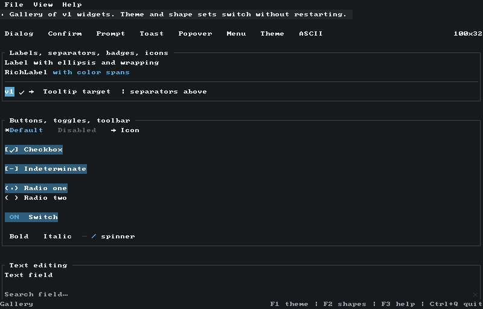

# terminal-window-gui

Cell-grid GUI components for [`terminal-window`](https://github.com/psiwray-corp/terminal-window):
panels, labels, buttons, editors, lists, tables, trees, tabs, menus, dialogs,
overlays, and status displays rendered into a terminal matrix.

**Status:** `1.0.0` release line. The library is passive: the caller owns the
window, service, owner thread, frame loop, timers, input delivery, close, and
OpenGL. See [`GUIDE.md`](GUIDE.md) for the build history and section status.



## Install

```kotlin
dependencies {
    implementation("com.psiwray.organization:terminal-window-gui:1.0.0")
}
```

`terminal-window:2.0.0` is an `api` dependency. Add its LWJGL natives and
platform libraries exactly as for any `terminal-window` application. The GUI
does not add LWJGL, GLFW, JOML, or native classifiers to the consumer POM.

## Requirements

- JDK 25 at runtime and build time.
- Kotlin 2.4.21 when compiling from source.
- A `terminal-window` application with its normal desktop OpenGL 3.3
  requirements. The GUI library itself calls no GL, GLFW, or window method.

## Quickstart

The library does not own a window or loop. Open a `terminal-window` window as
usual, then drive one `GuiSurface` from the host owner thread:

```kotlin
fun run(root: Widget, window: TerminalWindow) {
    val surface = GuiSurface(
        root = root,
        theme = Themes.dark(),
        shapes = ShapeSets.unicode().resolve(GuiFonts.bundled()),
    )
    surface.resize(window.matrix.columns, window.matrix.rows)
    var pointerColumn = 0
    var pointerRow = 0
    var appliedCursor: CursorShape? = null

    window.addInputListener(object : InputListener {
        override fun onKey(event: KeyEvent) = surface.dispatch(GuiInput.key(event))
        override fun onChar(event: CharEvent) = surface.dispatch(GuiInput.char(event))
        override fun onMouseButton(event: MouseButtonEvent) = surface.dispatch(GuiInput.button(event))
        override fun onScroll(event: ScrollEvent) =
            surface.dispatch(GuiInput.scroll(event, pointerColumn, pointerRow))
        override fun onFocus(event: FocusEvent) = surface.dispatch(GuiInput.focus(event))
        override fun onMouseMove(event: MouseMoveEvent) {
            pointerColumn = event.column
            pointerRow = event.row
            surface.dispatch(GuiInput.move(event))
        }
    })

    while (!window.shouldClose) {
        window.frame()
        if (surface.size.columns != window.matrix.columns ||
            surface.size.rows != window.matrix.rows
        ) {
            surface.resize(window.matrix.columns, window.matrix.rows)
        }
        surface.tick(System.nanoTime())
        if (surface.needsPaint) {
            surface.paint(CellCanvas(window.matrix))
            window.requestRepaint()
        }
        val cursor = surface.pointerShape
        if (cursor != null && cursor != appliedCursor) {
            window.setCursor(cursor)
            appliedCursor = cursor
        }
        Thread.sleep(15)
    }
    window.close()
}
```

Dispatch never paints; `paint` writes the complete matrix; `tick` runs only due
timers. The caller decides resize, repaint, cursor, sleep, and close cadence.
`root` must be a single unparented `Widget`; see [architecture](docs/architecture.md).

## Shapes and fonts

Widgets request semantic `Shape` roles; `ShapeSets.unicode()` supplies standard
Unicode primaries with ASCII fallbacks, and `ShapeSets.ascii()` is the ASCII
catalog. `GuiFonts.bundled()` loads the CC0 8x16 `.twf` font covering ASCII,
every v1 primary, and the reserved heavy box set. A missing primary uses its
fallback, then the global last resort, unless `MissingShapePolicy.FAIL` is
selected. See the [shape table](docs/shapes.md) and [theming](docs/theming.md).

## Scope

v1 includes layout wrappers, display primitives, buttons/toggles, text controls,
lists/tables/trees, tabs/splits/forms/screens, menus/dialogs/overlays,
scrollbars, progress/spinner/banner, and `AppShell`/`StatusBar`/`Toolbar`.

v1 deliberately excludes text attributes, wide characters, grapheme clusters,
IME, images, OS clipboard, runtime font switching, RTL, accessibility, charts,
and a native window manager. The exact limits and v1.1 prerequisites are in
[compatibility](docs/compatibility.md) and [roadmap](docs/roadmap.md).

Coordinates are local to the parent content box, sizing uses one
`measure(Constraints) -> IntSize` path, and a full `paint` writes the caller's
`TerminalMatrix`. See [testing](docs/testing.md) for the conformance policy.

## Modules and examples

| Module | Role |
|---|---|
| `:library` | Published GUI library |
| `:examples` | Gallery, TODO, dashboard, custom-widget proofs; not published |

There is no `:benchmarks` module and no timing gate. Correctness uses structural
cell grids, synthetic events, and a fake clock.

```bash
./gradlew :examples:gallery
./gradlew :examples:todo
./gradlew :examples:dashboard
./gradlew :examples:custom
```

Every example accepts `--smoke` (ten frames, draw-call assertion, 20 s
watchdog); CI runs the smoke under Xvfb. Committed screenshots use the bundled
font and dark theme; see [`docs/assets/`](docs/assets/).

## Documentation

- [Build guide](GUIDE.md)
- [Architecture](docs/architecture.md) · [Public API](docs/public-api.md)
- [Layout](docs/layout.md) · [Input](docs/input.md) · [Theming](docs/theming.md)
- [Widgets](docs/widgets.md) · [Shapes](docs/shapes.md)
- [Compatibility](docs/compatibility.md) · [Roadmap](docs/roadmap.md)
- [Testing](docs/testing.md) · [Release runbook](docs/release/runbook.md)
- [Contributing](CONTRIBUTING.md) · [Changelog](CHANGELOG.md)

## License

MIT. The bundled bitmap font is CC0-1.0 with attribution; see
[LICENSE](LICENSE) and [Shapes](docs/shapes.md).
