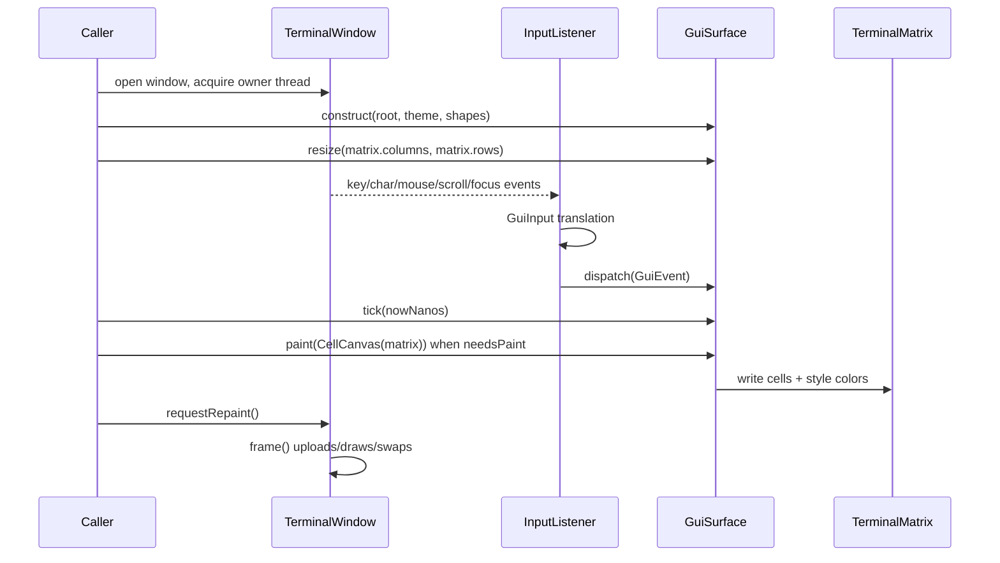

# Architecture

This document is the structural contract for `terminal-window-gui` 1.0. It
fixes package placement, ownership, layout and paint rules, and the caller
integration sequence. It does not implement widgets.

- Decisions: [`docs/adr/`](adr/).
- Public API inventory: [`docs/public-api.md`](public-api.md).
- Compatibility policy: [`docs/compatibility.md`](compatibility.md).
- Testing policy: [`docs/testing.md`](testing.md).
- v1.1 roadmap: [`docs/roadmap.md`](roadmap.md).
- Build guide: [`GUIDE.md`](../GUIDE.md).

## Package map

Root package: `com.psiwray.organization.terminal_window_gui`.

| Package | Contents | Visibility |
|---|---|---|
| `...terminal_window_gui` | `GuiSurface`, `GuiInput`, `GridSize`, `GuiException` | Public |
| `...terminal_window_gui.widget` | `Widget`, containers, layout wrappers, built-in widgets, editing controls, menus, dialogs, and overlays | Public |
| `...terminal_window_gui.layout` | `Constraints`, `IntSize`, `Rect`, `Length`, `Axis`, `Alignment`, `MainAxisAlignment`, `CrossAxisAlignment`, `MainAxisSize`, `Overflow` | Public |
| `...terminal_window_gui.paint` | `CellCanvas`, `PaintContext`, `TextMetrics`, `TextLayout`, `TextWrap`, `TextAlignment` | Public; stack internals hidden |
| `...terminal_window_gui.shape` | `Shape`, `ShapeSpec`, `ShapeSet`, `ShapeSets`, `ResolvedShapeSet`, `MissingShapePolicy`, `MissingShapeException`, `GuiFonts` | Public |
| `...terminal_window_gui.style` | `Theme`, `Style`, `Themes`, `WidgetState` | Public |
| `...terminal_window_gui.text` | `TextEditingController`, `TextSelection` | Public |
| `...terminal_window_gui.input` | `GuiEvent` and subtypes, `EventRouter`, `FocusManager`, `FocusScope`, `FocusTraversal`, `OverlayHost`, `OverlayEntry`, `OverlayAnchor`, `OverlayPlacement`, `DismissPolicy`, `HoverState`, `PointerCapture`, `Scheduler`, `TimerHandle`, `Clipboard`, `InMemoryClipboard` | Public; routing internals hidden |
| `...terminal_window_gui.command` | `Command`, `KeyChord`, `Keymap` | Public |
| `...terminal_window_gui.internal` | layout caches, paint-stack storage, hit-test helpers, overlay plumbing, implementation details | Internal |

Rules:

1. `internal` never appears in a public signature.
2. Public signatures never expose GLFW, OpenGL, LWJGL, window handles, or
   service types.
3. `terminal-window` types appear only at the caller-facing boundary:
   `BitmapFont`, `TerminalMatrix`, input event types used by `GuiInput`, `Key`,
   `KeyAction`, `Modifiers`, `MouseButton`, and `CursorShape`.
4. `.paint` and `.shape` are pure Kotlin over `TerminalMatrix` and
   `BitmapFont`; they do not call a window or GL.
5. `.widget` may depend on `.layout`, `.paint`, `.shape`, `.style`, `.input`,
   and `.command`.
6. `.internal` may depend on every package; no package cycle is allowed.
7. `GuiSurface` is the only root bridge that constructs the runtime services
   (`FocusManager`, `Scheduler`, `OverlayHost`, `HoverState`).

The automatic module name is `com.psiwray.organization.terminal_window_gui`.
No `module-info.class` is shipped in 1.0; the JAR carries
`Automatic-Module-Name` in its manifest. A future real module descriptor that
restricts exports is a compatibility change.

## Object map

Types below belong to the listed section. A section may add private helpers,
but not move a type across the public/internal boundary.

| Type | Package | Owner | Responsibility |
|---|---|---|---|
| `GuiSurface` | root | 06 | Passive resize/dispatch/tick/paint surface; exposes focus, scheduler, clipboard, overlay host, hover state, keymap, and runtime `setTheme`/`setShapes` replacement |
| `GuiInput` | root | 06 | Pure translation from `terminal-window` input values to `GuiEvent` |
| `GridSize` | root | 06 | Immutable columns/rows value |
| `GuiException` | root | 06 | Base unchecked exception for GUI-layer failures |
| `Widget` | `.widget` | 04 | Base tree node: measure, arrange, paint, event sink, focusability, style, invalidation |
| `ContainerWidget` | `.widget` | 04 | Ordered child container with parent/clip and child-management rules |
| `SingleChildWidget`, `MultiChildWidget` | `.widget` | 04 | Convenience bases for one/many children |
| `LayoutWidget` | `.widget` | 04 | Base for wrappers that lay out children without owning state |
| `Row`, `Column`, `Stack`, `Grid`, `Wrap` | `.widget` | 04 | Axis, overlay, track, and flow layout |
| `Padding`, `SizedBox`, `Align`, `Center`, `FractionallySizedBox`, `ConstrainedBox`, `Spacer` | `.widget` | 04 | Constraint, spacing, and alignment wrappers |
| `ScrollView` | `.widget` | 07 | Two-axis viewport over a scrollable child with clipping |
| `ScrollModel` | `.widget` | 07 | Content/viewport sizes, offsets, clamping, and line/page movement |
| `ScrollBar` | `.widget` | 07 | Optional track/thumb and arrow controls for a `ScrollModel` |
| `Panel`, `Separator`, `Spacer`, `Label`, `RichLabel`, `Badge`, `Icon` | `.widget` | 07 | Display primitives and themed decoration |
| `ProgressBar`, `Spinner`, `Banner`, `Toolbar` | `.widget` | 07 | Display and action containers |
| `Button`, `Checkbox`, `RadioGroup`, `RadioButton`, `Switch` | `.widget` | 08 | Action and toggle controls |
| `TextField`, `SearchField` | `.widget` | 09 | Single-line editors and `TextEditingController`-backed state |
| `TextArea`, `LogView` | `.widget` | 09 | Wrapped multi-line editor and read-only log |
| `TextEditingController`, `TextSelection` | `.text` | 09 | Editable text, selection range, undo/redo, and clipboard commands |
| `SelectionModel`, `SelectionMode` | `.widget` | 10 | Stable-key selection, cursor, anchor, and range state |
| `ListView` | `.widget` | 10 | Virtualized single/multi selection list |
| `TableView`, `TableColumn`, `ColumnWidth`, `TableCell`, `SortDirection` | `.widget` | 10 | Virtualized table with header, rows, and sort display |
| `TreeView`, `TreeNode` | `.widget` | 10 | Expanded-node tree with keyboard navigation |
| `Tab`, `TabBar`, `TabView` (`Tabs`) | `.widget` | 11 | Scrolling tab bar and active-only content with focus restore |
| `SplitPane`, `SplitOrientation` | `.widget` | 11 | Two panes with a draggable and keyboard-adjustable splitter |
| `Form`, `FormField` (`Field`), `FormLabelWidth` | `.widget` | 11 | Label/control/help/error form layout |
| `AppShell` | `.widget` | 11 | Menu bar, content, and status bar without window ownership |
| `StatusBar`, `KeyHint` | `.widget` | 11 | Segmented status items and formatted key hints |
| `Screen`, `ScreenHost` | `.widget` | 11 | Pushed/popped screens, per-screen keymaps, resize, and focus restore |
| `MenuBar`, `Menu`, `MenuItem`, `MenuPopup`, `ContextMenu` | `.widget` | 12 | Menus and popup menus |
| `Dialog`, `DialogAction`, `DialogResult`, `ConfirmDialog`, `PromptDialog` | `.widget` | 12 | Modal content and action rows |
| `Popover`, `Tooltip`, `TooltipController`, `Toast`, `ToastManager`, `ToastCorner` | `.widget` | 12 | Anchored overlays and transient notices |
| `Constraints` | `.layout` | 04 | Inclusive min/max cell constraints |
| `IntSize`, `Rect` | `.layout` | 03/04 | Immutable integer geometry |
| `Length`, `Axis`, `Alignment` | `.layout` | 04 | Fixed/fill/fraction/wrap lengths and alignment |
| `Positioned`, `Flexible`, `Expanded` | `.layout` | 04 | Parent-data markers for stack and flex children |
| `CellCanvas` | `.paint` | 03 | Absolute screen-cell writer with clip and origin stack |
| `PaintContext` | `.paint` | 03 | Widget-local paint API with translated clip/origin |
| `TextMetrics`, `TextLayout` | `.paint` | 03 | Deterministic code-point measurement and wrapping |
| `TextWrap`, `TextAlignment` | `.paint` | 03 | Wrap and alignment policy values |
| `Shape` | `.shape` | 03 | Semantic shape role enum |
| `ShapeSpec` | `.shape` | 03 | Primary and optional per-shape fallback code point |
| `ShapeSet`, `ShapeSets`, `ResolvedShapeSet` | `.shape` | 03 | Immutable shape catalogs and font-resolved catalog |
| `MissingShapePolicy`, `MissingShapeException` | `.shape` | 03 | Strictness and diagnostic for missing glyphs |
| `GuiFonts` | `.shape` | 03 | Bundled font loading |
| `Theme`, `Style`, `Themes`, `WidgetState` | `.style` | 05 | Immutable color tokens and state styles |
| `GuiEvent` and subtypes | `.input` | 05 | Immutable key, char, pointer, scroll, focus, and close events |
| `EventRouter` | `.input` | 05 | Tree hit testing, dispatch, capture/bubble, consumption |
| `FocusManager`, `FocusScope` | `.input` | 05 | Focus tree, tab order, traps, and restore |
| `OverlayHost`, `OverlayEntry` | `.input` | 05 | Screen-coordinate overlay stack, z-order, modal blocking |
| `HoverState` | `.input` | 05 | Latest hovered widget/path |
| `Scheduler` | `.input` | 05 | Caller-driven due timers; no threads |
| `Clipboard`, `InMemoryClipboard` | `.input` | 05 | Caller-supplied clipboard interface and default |
| `Command`, `KeyChord`, `Keymap` | `.command` | 05 | Actions, key bindings, and global shortcuts |
| Layout caches, paint stacks, hit-test helpers | `.internal` | 04-06 | Non-public implementation |

The concrete control names are fixed by `GUIDE.md`; the 1.0 catalog, including
the deferred `Select`, is authoritative in [`public-api.md`](public-api.md) and
[`widgets.md`](widgets.md). A section may add private helpers, but every public
control above must be covered by the conformance registry in section 14.

## Thread map

`GuiSurface` and every attached widget are **single-thread-affine**. There is
no synchronization and no internal executor.

| Execution context | Work | Never does |
|---|---|---|
| Caller/surface thread | Construct `GuiSurface`; `resize`, `dispatch`, `tick`, `paint`; widget state, layout, focus, overlays, clipboard, scheduler | Call GL, GLFW, `TerminalWindow`, or `TerminalWindowService` |
| Caller's `terminal-window` owner thread | `window.frame()`, host input listener, read `window.matrix`, call `window.requestRepaint()` and `window.setCursor` | Touch GUI state from another thread or call GUI internals concurrently |
| Any thread | Immutable values (`GridSize`, `Rect`, `Shape`, `Theme`, events); `GuiInput` pure translation; `BitmapFont.parse`; `ShapeSet.resolve` on an immutable set | Mutate a `GuiSurface`, a widget, a layout cache, or a clipboard attached to a surface |
| Caller-supplied clipboard implementation | `Clipboard` methods when invoked by surface-thread code | Assume the GUI provides synchronization |
| Library internals | None | Create threads, coroutines, watchers, or background repaint |

The host may run the GLFW service and window owner on different threads; the
GUI does not care. Normally the caller makes the host owner thread the surface
thread: it translates input in the host listener, dispatches, and paints on
that same thread. A caller that uses a separate UI thread must hand events to
that thread before calling `dispatch`; the GUI provides no queue and no
synchronization, and only one thread may call surface methods.

## Paint cycle

The GUI paint cycle is a pure function from widget state to matrix cells. The
host frame loop is separate. The thread-affinity table and the exact public
inventory live in [`public-api.md`](public-api.md).



Ordering rules:

1. **Construct once.** `GuiSurface(root, theme, shapes)` creates the services.
   The root is attached with no parent.
2. **Resize before use.** `resize(columns, rows)` sets the root bounds to
   `(0, 0, columns, rows)`, invalidates layout, clamps scroll models, and marks
   paint. `paint` requires the canvas dimensions to equal `surface.size`.
3. **Dispatch.** `dispatch` ensures layout is current, routes overlays first
   (topmost to bottom), then the root tree. A modal overlay consumes input
   below it. Dispatch never paints.
4. **Tick.** `tick(nowNanos)` runs due scheduler callbacks only. It does not
   sleep, poll, or schedule itself. The caller chooses the cadence.
5. **Paint.** `paint` ensures layout is current, fills the canvas with
   `theme.background`, paints the root, then paints overlays. It does not
   upload, draw, swap, or call the host.
6. **Host frame.** The caller asks the host for a repaint when
   `surface.needsPaint` was true. The host renders the matrix on its next
   `frame()`/swap opportunity.
7. **Pointer shape.** The caller may read `surface.pointerShape` and apply it
   with `TerminalWindow.setCursor`; the library never calls the window.
8. **Clear flags.** `needsLayout` clears only after successful layout;
   `needsPaint` clears only after successful paint. A thrown widget preserves
   both flags for retry.

There is no internal timer thread and no automatic frame request. A cursor
blink, spinner, or toast delay exists only if the caller calls `tick`.

## Coordinate rules

- The root rectangle is `(0, 0, columns, rows)` in root-local space.
- Every child bounds is local to its parent's **content box**, not the
  screen.
- `measure` and `arrange` use integer cell units.
- `PaintContext` owns an origin stack and a clip stack. Local drawing is
  translated by the current origin before it reaches `CellCanvas`.
- `pushClip(localRect)` translates the rectangle by the current origin, then
  intersects it with the current clip. Clips are half-open.
- Nested origins accumulate by integer addition. There is no scaling or
  rotation.
- `CellCanvas` writes absolute screen cells and enforces the matrix bounds.
- Overlays are anchored and stored in screen coordinates because they can
  escape the root and are painted after it.
- Pointer events arrive in screen cells (or pixels for host moves); hit
  testing converts them to local coordinates by subtracting accumulated
  origins.
- A custom widget paints only through `PaintContext`; it must not cache
  absolute screen positions across layouts.

## Size model

One public measure path:

```text
parent.measure(constraints) -> child.measure(childConstraints)
                               -> IntSize
parent.arrange(child, localRect)
```

- `Constraints` has inclusive min/max width and height.
- Preferred size is computed from content and style during measurement.
- Minimum size is a content clamp or `ConstrainedBox`.
- Maximum size is the parent constraint or `ConstrainedBox`/`SizedBox`.
- `Length` chooses fixed, fill, fraction, or wrap behavior.
- `Flexible`/`Expanded` distribute main-axis leftover space.
- Layout caches are valid only for one pass and are invalidated by state,
  theme, or constraint changes.
- No widget exposes mutable `preferredSize`, `minimumSize`, or
  `maximumSize` fields.
- A widget may not return a size outside the constraints it received.
- Layout is idempotent for unchanged inputs.

`ScrollView` measures its content with an unbounded scroll-axis constraint and
clips the viewport. `TableView`, `ListView`, and `TreeView` virtualize by
building only visible rows.

## Shape resolution

`GuiSurface` accepts a `ResolvedShapeSet`, not a raw font. The resolution order
is:

1. primary code point, if `font.hasGlyph`;
2. per-shape fallback, if declared;
3. global `lastResortCodePoint` (default U+003F), if present;
4. otherwise throw `MissingShapeException`.

`MissingShapePolicy.FAIL` rejects any missing primary, even when a fallback is
available. `ShapeSets.unicode()` carries standard Unicode primaries and ASCII
fallbacks; `ShapeSets.ascii()` maps every role to ASCII. `GuiFonts.bundled()`
loads `terminal-window-gui-8x16.twf`, which covers ASCII, every v1 primary,
the reserved heavy box set, and every ASCII fallback.

Widgets request `Shape` roles. They do not hardcode glyph code points and do
not inspect `BitmapFont` directly.

## Caller-owned integration sequence

This is a shape, not an implementation. The caller owns every host call.

```text
service = TerminalWindowService.initialize()
window = service.openWindow(config)
window.addInputListener { event ->
    // Translate with GuiInput.key/char/move/button/scroll/focus, then:
    // surface.dispatch(guiEvent) on the host owner thread.
}

surface = GuiSurface(root, theme, shapes)
surface.resize(window.matrix.columns, window.matrix.rows)
appliedCursor = null

while (!window.shouldClose) {
    window.frame()                         // host input + render opportunity
    if (surface.size.columns != window.matrix.columns ||
        surface.size.rows != window.matrix.rows) {
        surface.resize(window.matrix.columns, window.matrix.rows)
    }
    surface.tick(System.nanoTime())
    if (surface.needsPaint) {
        surface.paint(CellCanvas(window.matrix))
        window.requestRepaint()
    }
    if (surface.pointerShape != appliedCursor) {
        surface.pointerShape?.let { window.setCursor(it) }
        appliedCursor = surface.pointerShape
    }
}

window.close()
service.close()
```

Important details:

- `window.frame()` is host-owned and must be called on the host's owner thread.
- The input listener runs on the host owner thread; it must not call `paint`.
- The first paint can be one frame behind the first dispatch; this is the
  caller's cadence choice.
- `window.requestRepaint()` is a one-shot request; it does not create a loop.
- The surface never sees the window, service, GL, or input callbacks.
- On macOS, the caller supplies `-XstartOnFirstThread`; the library does not.
- The `:examples` module has its own helper loop; that helper is not part of
  the published library.

## Error model

- `IllegalArgumentException`: invalid dimensions, code points, constraints,
  event values, or style tokens.
- `IllegalStateException`: a surface operation before `resize`, a widget
  attached twice, a paint stack overflow, or cross-thread use detected by a
  caller-owned guard.
- `MissingShapeException`: no primary, fallback, or last resort for a shape.
- `GuiException`: a GUI-layer failure with a stable message category.
- No `System.exit`, no global exception handler, no swallowed errors.
- A widget exception aborts the current paint; layout and paint dirty flags are
  preserved.

## Decision index

| Concern | ADR |
|---|---|
| Coordinates, version, package root | ADR-0001 |
| License and font license | ADR-0002 |
| JDK/Kotlin/Gradle and dependency boundary | ADR-0003 |
| Modules and publication scope | ADR-0004 |
| Passive surface and ownership | ADR-0005 |
| Local coordinates and paint transform | ADR-0006 |
| One measure path | ADR-0007 |
| Semantic shapes and bundled font | ADR-0008 |
| v1 component scope | ADR-0009 |
| Testing and conformance | ADR-0010 |
| v1.1 roadmap and host gaps | ADR-0011 |
| Release and Maven Central | ADR-0012 |

## Related

[Public API](public-api.md) · [Compatibility](compatibility.md) ·
[Roadmap](roadmap.md) · [Testing](testing.md) ·
[Build guide](../GUIDE.md)
